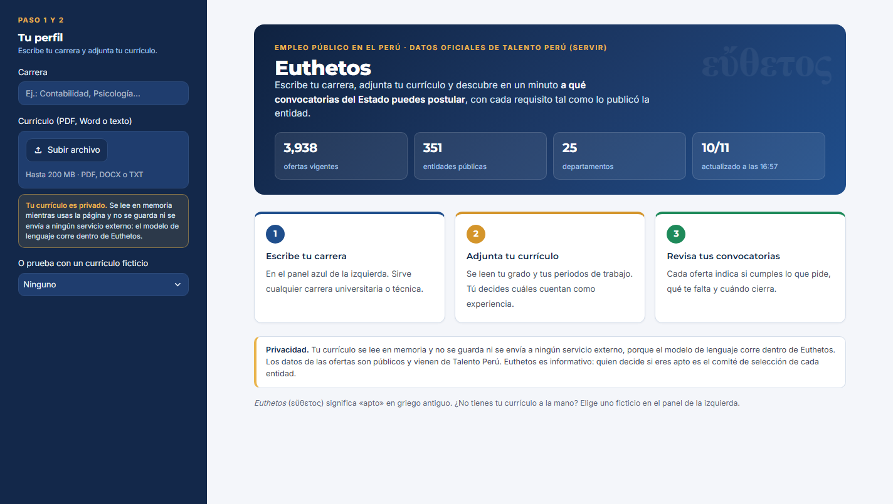
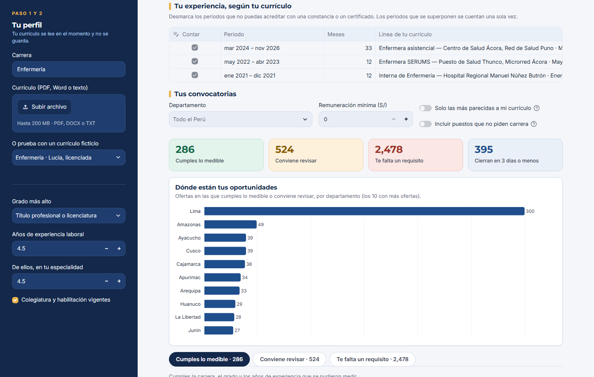
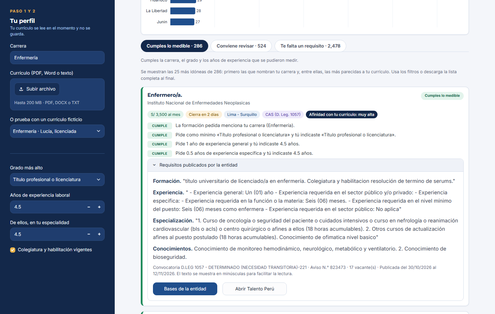
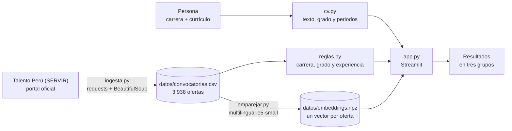

# Euthetos

> *Euthetos* (εὔθετος) significa "apto" o "bien dispuesto para algo" en griego antiguo.

[](https://github.com/saffron29/euthetos/actions/workflows/pruebas.yml)

**Hacemos que cualquier profesional sepa en un minuto a qué convocatorias del Estado peruano puede postular,
mediante un lector de requisitos que compara su currículo con todas las ofertas vigentes de Talento Perú.**

### [Abrir Euthetos → euthetos.streamlit.app](https://euthetos.streamlit.app/)

Para probarla sin un currículo propio: [enfermera](https://euthetos.streamlit.app/?ejemplo=enfermeria) ·
[ingeniero civil](https://euthetos.streamlit.app/?ejemplo=ingenieria_civil) ·
[abogada](https://euthetos.streamlit.app/?ejemplo=derecho) (currículos ficticios).

| 3,938 | 351 | S/ 0 |
|:---:|:---:|:---:|
| ofertas laborales vigentes del Estado al 10/11/2026, de todos los regímenes (la aplicación muestra solo las que siguen abiertas) | entidades públicas en los 25 departamentos | de costo por consulta: el modelo de lenguaje es abierto y corre dentro de la aplicación |



## Cómo funciona

| 1. Escribe tu carrera y adjunta tu currículo | 2. Confirma tu experiencia | 3. Revisa tus convocatorias |
|---|---|---|
| Cualquier carrera, universitaria o técnica. El currículo puede estar en PDF, Word o texto, y no se guarda. | Euthetos muestra cada periodo de trabajo que leyó del currículo; se desmarcan los que no pueden acreditarse. | Las ofertas se separan en **cumples lo medible**, **conviene revisar** y **te falta un requisito**, con el motivo y el texto literal de cada requisito. Se pueden filtrar por palabra, departamento, régimen laboral y sueldo. |

**Resultados para una enfermera ficticia:** sus periodos de trabajo, el resumen de resultados y dónde están sus oportunidades.



**Detalle de una oferta:** el motivo de cada requisito y, desplegado, el texto literal publicado por la entidad.



---

## Índice

1. [Propuesta en una frase](#1-propuesta-en-una-frase-one-liner)
2. [Fundador](#2-fundador-founder)
3. [Problema](#3-problema)
4. [Solución e idea clave](#4-solución-e-idea-clave-insight)
5. [Por qué ahora](#5-por-qué-ahora-why-now)
6. [Demostración](#6-demostración)
7. [Modelo de negocio](#7-modelo-de-negocio)
8. [Herramientas del curso](#8-herramientas-del-curso)
9. [Qué hizo el agente](#9-qué-hizo-el-agente)
10. [Competencia, primeros usuarios, hoja de ruta y riesgos](#10-competencia-primeros-usuarios-hoja-de-ruta-y-riesgos)

---

## 1. Propuesta en una frase (*one-liner*)

Hacemos que **cualquier profesional, de cualquier carrera**, sepa en un minuto **a qué convocatorias del Estado
peruano puede postular**, mediante un lector que compara su carrera, su grado y sus años de experiencia con los
requisitos de **todas las ofertas vigentes de Talento Perú**, desde el régimen CAS hasta los decretos legislativos
276 y 728 y la Ley del Servicio Civil.

## 2. Fundador (*founder*)


Frank Pinares Gutiérrez es licenciado en Ciencia Política y Gobierno por la Pontificia Universidad Católica del
Perú (2026) y cursa la Diplomatura de Especialización en Ciencia de Datos para las Ciencias Sociales y la Gestión
Pública (Q-Lab PUCP).

Durante muchos años ha postulado a puestos en varias entidades públicas, de modo que conoce de primera mano el
problema: revisar convocatoria por convocatoria si se cumplen los requisitos, para descubrir muchas veces, al
final de la lectura, que alguno no se cumple. Antes de Euthetos, el autor ya había construido para su propia
búsqueda un buscador diario de convocatorias y un preparador de postulaciones, y de ellos proviene la experiencia
con el portal de Talento Perú en la que se apoya el presente proyecto.

<br clear="left">

## 3. Problema

**Quién lo sufre.** Toda persona que busca trabajo en el Estado peruano. Al 10 de noviembre de 2026, Talento Perú
publicaba 3,938 ofertas vigentes de 351 entidades; el 41% correspondía a Lima.

**Cuánto le cuesta.** El portal muestra diez ofertas por página y su buscador encuentra la frase literal que se escribe
en el perfil, sin decir si se cumple. Por eso, para saber si se cumple una oferta, debe abrirse su detalle y leerse cuatro secciones: formación,
experiencia, especialización y conocimientos. A un programa, con una pausa de dos segundos entre pedido y pedido,
leer las 428 páginas y todos sus detalles le tomó unas 2 horas y 45 minutos; para una persona, la misma lectura
equivaldría a varios días.

Ahora bien, la mayor parte de esa lectura no sirve para nada. Con las reglas de Euthetos se calculó cuántas de las
3,938 ofertas nombran la carrera de cuatro perfiles de ejemplo y además piden un grado y una experiencia que esos
perfiles cumplen:

| Perfil de ejemplo | Ofertas que le sirven en lo medible | Proporción |
|---|---:|---:|
| Abogada titulada y colegiada, con 6.5 años de experiencia | 727 | 18.5% |
| Enfermera licenciada y colegiada, con 4.5 años | 286 | 7.3% |
| Ingeniero civil bachiller, con 5.5 años | 22 | 0.6% |
| Politólogo recién titulado, con 6 meses | 0 | 0.0% |

Es decir, una persona que revisa las ofertas a mano lee entre 5 y 179 avisos por cada uno que le sirve, y quien
recién empieza su carrera puede leerlos todos sin encontrar ninguno. Asimismo, la mediana de experiencia general
exigida es de dos años, y solo el 33% de las ofertas pide un año o menos.

**Cómo lo resuelve hoy.** Para saberlo, se conversó por WhatsApp con tres profesionales de carreras distintas.
Las notas completas, con sus respuestas literales, se encuentran en [`docs/research/`](docs/research/), junto con
la guía de preguntas utilizada.

| Conversación | Perfil | Resumen |
|---|---|---|
| [1](docs/research/conversacion_1.md) | Sociología; hoy trabaja sobre todo en ONG; revisó una convocatoria hace un año | Leía las bases de cada convocatoria, lo que le tomaba algunos minutos por aviso, y al inicio de su carrera quedó "no apto" muchas veces. Se enteraba por contactos y por una página que reúne convocatorias. La herramienta le pareció útil, aunque señaló que otras páginas ya lo hacen; no sabe si pagaría, pero cree que las instituciones grandes sí lo harían |
| [2](docs/research/conversacion_2.md) | Derecho; revisó convocatorias una semana antes | Leía los documentos y las bases de cada convocatoria, lo que describió como mucho trabajo, y trataba de no perder tiempo en las que no eran de su perfil. Se entera por avisos de conocidos y por la web de SERVIR. Cree que la herramienta ahorraría mucho tiempo, pero que podría mejorarse con más funciones |
| [3](docs/research/conversacion_3.md) | Psicología; se ha dedicado sobre todo al sector privado | Leía las bases para decidir si convenía postular y, así, evitar quedar "no apto". Usaba una página que reúne convocatorias. Cree que la herramienta tiene potencial, pero que necesita más funciones |

De estas conversaciones se desprenden cuatro hallazgos. En primer lugar, las tres personas resolvían el problema
de la misma manera: leyendo las bases de cada convocatoria, una por una, lo cual una de ellas describió como mucho
trabajo. En segundo lugar, quedar "no apto" fue frecuente al inicio de la carrera, mientras que las otras dos
personas leían las bases precisamente para evitarlo; es decir, el costo principal es el tiempo de lectura. En
tercer lugar, solo una persona busca en la web de SERVIR: las demás se enteran por sus contactos o por páginas que
reúnen convocatorias, que se comparan en la [sección 10](#10-competencia-primeros-usuarios-hoja-de-ruta-y-riesgos).
Por último, las tres valoraron la herramienta, pero coincidieron en que le faltan funciones, sin precisar cuáles, y
ninguna dijo que pagaría por las alertas; una opinó que sí pagarían las instituciones grandes. Cabe precisar que se
trata de tres respuestas breves por mensaje, de modo que son indicios y no una medición (además, al provenir de
contactos del autor, pueden ser más favorables que las de un desconocido).

## 4. Solución e idea clave (*insight*)

**Solución.** Euthetos lee del currículo el grado más alto y los periodos de trabajo, y muestra cada periodo junto
con la línea de la que salió, para que la persona desmarque los que no puede acreditar. Con ese perfil confirmado,
compara cada oferta vigente y la ubica en uno de tres grupos:

- **Cumples lo medible:** la oferta nombra la carrera y se cumplen el grado y los años de experiencia.
- **Conviene revisar:** nada descarta a la persona, pero hay algo que debe leer ella misma (carreras afines,
  colegiatura, posgrado o un texto poco claro).
- **Te falta un requisito:** sirve para saber qué separa a la persona de cada puesto. Además, el recuadro
  **"Qué te acercaría a más ofertas"** vuelve a aplicar las mismas reglas cambiando un solo dato del perfil, y
  muestra cuántas de esas ofertas se abrirían con uno o dos años más de experiencia o con el nivel de estudios
  siguiente. Por ejemplo, al ingeniero civil bachiller del ejemplo, el título profesional le abriría 243 ofertas más.

Dentro de cada grupo, primero aparecen las ofertas que nombran la carrera y luego las más parecidas al currículo, y
la lista puede acotarse con un buscador de palabras y con filtros por departamento, régimen laboral y sueldo mínimo.
Cada oferta muestra por qué quedó en su grupo, el texto literal publicado por la entidad y el enlace a sus bases.

**Idea clave.** Talento Perú ya publica los requisitos separados en secciones, de manera que lo medible puede leerse
con reglas transparentes y comprobables, sin un modelo de lenguaje de pago que "decida" si alguien es apto. Así, la
inteligencia artificial se reserva para lo que las reglas no resuelven, es decir, ordenar miles de ofertas según su
parecido con un currículo; y para ello basta un modelo abierto y pequeño. De esta forma, el costo por usuario es
prácticamente nulo, el currículo no se envía a ningún servicio externo y cada resultado puede verificarse contra el
texto original.

## 5. Por qué ahora (*why now*)

- **Modelos abiertos, pequeños y en español.** `intfloat/multilingual-e5-small` tiene 118 millones de parámetros,
  entiende el español y convierte un currículo en un vector en 0.18 segundos en el procesador de una laptop, sin
  clave ni costo por consulta.
- **Publicación gratuita.** Streamlit Community Cloud permite publicar la aplicación sin un servidor propio.
- **Agentes de programación.** El flujo completo, desde la lectura del portal hasta la aplicación publicada, se
  construyó en un día con un agente de programación, lo cual hace viable que una sola persona mantenga el producto.

## 6. Demostración

**Dirección pública:** https://euthetos.streamlit.app/ (Streamlit Community Cloud). Si la aplicación estuvo
inactiva, la primera visita tarda alrededor de un minuto en despertarla y en cargar el modelo de lenguaje.

**Video de respaldo:** [docs/video/euthetos_demo.mp4](docs/video/euthetos_demo.mp4) (74 segundos, sin audio, con subtítulos). Muestra el flujo completo con la aplicación real y el currículo ficticio del ingeniero civil:
el currículo, la carrera, los periodos de trabajo, los resultados, una oferta con su texto literal y el recuadro
"Qué te acercaría a más ofertas". Se generó de forma automática, con un navegador sin ventana que recorre la
aplicación y toma capturas continuas; la única edición es un corte de unos segundos mientras la aplicación
compara el perfil con las ofertas.

**Correrla en una computadora propia:**

```bash
python -m venv .venv
.venv\Scripts\activate            # en Windows; en Mac o Linux: source .venv/bin/activate
pip install -r requirements.txt
streamlit run app.py
```

La primera vez se descarga el modelo de lenguaje (unos 470 MB). Para usar un currículo ficticio, basta elegirlo en
el panel izquierdo o añadir `?ejemplo=enfermeria`, `?ejemplo=ingenieria_civil` o `?ejemplo=derecho` al final de la
dirección.

**Actualizar los datos:**

```bash
python ingesta.py        # lee las ofertas vigentes de Talento Perú (unas 3 horas la primera vez)
python emparejar.py      # calcula los vectores de las ofertas (unos 10 minutos)
```

### Arquitectura



### Modelos y fuentes, y por qué

| Pieza | Qué se usa | Por qué |
|---|---|---|
| Fuente de datos | Talento Perú (SERVIR), leído con `requests` y `BeautifulSoup` | Es el portal oficial de ofertas del Estado y reúne todos los regímenes. No ofrece una interfaz de programación (API): la página es una aplicación JSF que se recorre enviando el formulario con su `ViewState`, con dos segundos de pausa entre pedidos |
| Resultado de cada oferta | Reglas escritas a mano (`reglas.py`), con 19 pruebas sobre textos reales que se corren automáticamente en GitHub con cada cambio | Son transparentes, gratuitas y comprobables: cada motivo se muestra junto al texto literal |
| Orden por parecido | `intfloat/multilingual-e5-small` con `sentence-transformers` | Modelo abierto que corre en el procesador, sin clave ni costo; es el mismo de la Sesión 08 del curso |
| Interfaz | Streamlit | Permite publicar gratis y probar el flujo completo en vivo |

No se usa ningún modelo generativo de pago: ningún modelo de lenguaje decide el resultado, y el currículo nunca
sale del servidor de la aplicación.

## 7. Modelo de negocio

**Quién paga.** La persona que busca empleo no paga por saber a qué puede postular: ese es el servicio de entrada.
Pagan, más adelante, dos tipos de clientes: la persona que quiere **alertas** cuando aparece una oferta que encaja con
su perfil, y las **instituciones** que acompañan a muchas personas en su búsqueda (oficinas de empleabilidad de
universidades e institutos, colegios profesionales y oficinas de empleo municipales).

**Precio, por etapas.** El precio sube a medida que el producto ofrece más de lo que hoy ofrece la versión 0.1:

| Etapa | Qué incluye | Precio |
|---|---|---|
| **Hoy · versión 0.1** | Búsqueda con el currículo y resultados con sus motivos | **Gratis.** Se ofrece un piloto de tres meses, sin costo, a una oficina de empleabilidad, a cambio de retroalimentación |
| **Versión 0.2** | Actualización diaria automática y alertas por correo de ofertas nuevas que encajan | **S/ 9.90 al mes** por persona |
| **Versión 1.0** | Panel institucional con los perfiles de sus egresados o agremiados, alertas para todos y un informe de los requisitos que más les faltan | **S/ 300 al mes** por institución, hasta 1,000 personas |

**Lo que dijeron las conversaciones.** Ninguna de las tres personas dijo que pagaría por las alertas, y una opinó
que las instituciones grandes sí lo harían. Por eso, el precio por persona de la versión
0.2 se mantiene como una hipótesis que debe comprobarse durante el piloto, mientras que el ingreso principal se
espera de las instituciones.

**Costo por usuario.**

| Concepto | Costo |
|---|---|
| Tokens de modelos de pago | S/ 0: no se usa ninguno |
| Cálculo del vector de un currículo | 0.18 segundos de procesador (medido en una laptop) |
| Servidor | S/ 0 en Streamlit Community Cloud; un servidor propio solo hará falta con cuentas de usuario |
| Actualización de las ofertas | Una lectura de Talento Perú al día; la primera tomó unas 3 horas y las siguientes solo abren las ofertas nuevas |
| Almacenamiento del currículo | Ninguno: se lee en memoria y no se guarda |

## 8. Herramientas del curso

| Herramienta | Sesión | Archivo | Para qué se usa |
|---|---|---|---|
| Extracción de datos de la web (*web scraping*) | 03 · Extracción web y APIs | [`ingesta.py`](ingesta.py) | Leer las ofertas vigentes y el detalle de cada una en Talento Perú |
| Representaciones vectoriales (*embeddings*) y búsqueda por significado, la "R" de RAG | 08 · Modelos de lenguaje y RAG | [`emparejar.py`](emparejar.py) | Ordenar las ofertas según su parecido con el currículo, con los prefijos `query:` y `passage:` del modelo e5 y el producto punto `E @ q`, como en `llms_a_prueba.ipynb` |
| Tablero interactivo y publicación | 05 · Visualización y tableros, y 12 · Despliegue | [`app.py`](app.py) | La aplicación que usa la persona |

Se eligieron estas herramientas porque el problema exige, en primer lugar, reunir datos que no tienen una interfaz
de programación (la extracción web) y, en segundo lugar, ordenar miles de textos según su significado y no según
palabras exactas (las representaciones vectoriales), siendo que un currículo y una oferta rara vez usan las mismas
palabras para decir lo mismo.

## 9. Qué hizo el agente

El código fue generado con un agente de programación (Claude Code), a partir de un diseño previo aprobado por el
autor y con revisiones manuales en cada etapa:

| Parte | Qué hizo el agente | Qué decidió o revisó el autor |
|---|---|---|
| Problema y alcance | Propuso cuatro ideas sin costo adicional | Eligió el problema, el nombre y el alcance: todas las carreras, todos los regímenes y ningún modelo de pago |
| `ingesta.py` | Adaptó el lector de Talento Perú de un proyecto anterior del autor y lo hizo reanudable | Aprobó la fuente y el ritmo de lectura |
| `reglas.py` y pruebas | Escribió las reglas, 19 pruebas con textos reales y la comprobación automática en GitHub (`.github/workflows/pruebas.yml`) | Revisó los resultados en la aplicación y aprobó que las pruebas se corran con cada cambio |
| `cv.py` | Escribió la lectura del currículo | Detectó que sumaba periodos no acreditables; de ahí salió la tabla de periodos que la persona confirma |
| `emparejar.py` | Llevó la búsqueda por significado de la Sesión 08 a las ofertas | — |
| `app.py` | Escribió la interfaz y tres rediseños, y propuso mejoras | Pidió una interfaz sin emojis y más profesional, luego con más color (con los tonos de su portafolio), letra más pequeña y un panel fijo; de las mejoras propuestas, aprobó el buscador, los filtros por régimen, el aviso de privacidad, la tabla de competencia y el recuadro "Qué te acercaría a más ofertas" |
| README | Redactó el borrador y calculó sus cifras | Pidió mejorarlo, cuestionó el precio inicial (de ahí el precio por etapas) y pidió reemplazar los términos en inglés |
| Conversaciones con usuarios | Escribió la guía de preguntas y su versión corta para WhatsApp, y ordenó las respuestas en notas | Hizo las conversaciones, pasó las respuestas literales y revisó las notas |
| Video de respaldo | Lo generó automáticamente con un navegador sin ventana que recorre la aplicación real | Lo pidió por no poder grabarlo a mano ese día y aprobó el resultado |

## 10. Competencia, primeros usuarios, hoja de ruta y riesgos

**Competencia.** Euthetos no compite por tener más ofertas, sino por responder la pregunta que las alternativas
actuales dejan abierta: *¿puedo postular?*

| Alternativa | Qué ofrece | Por qué no basta |
|---|---|---|
| Revisar las ofertas a mano | Control total sobre lo que se lee | Hay que abrir y leer cada detalle: entre 5 y 179 avisos por cada uno que sirve, según el perfil |
| Buscador de Talento Perú | Todas las ofertas del Estado, en el portal oficial | Encuentra la frase literal que se escribe en el perfil, diez ofertas por página, y no dice si se cumplen los requisitos |
| Portales que reúnen convocatorias (convocatoriasdetrabajo.com, portaltrabajos.pe, yaempleo.net) | Ofertas de varias fuentes, agrupadas por departamento, entidad o tema, y enlaces a las bases. Dos de las tres personas consultadas usaban una de estas páginas | La búsqueda es por palabras o por categoría; la verificación de los requisitos queda a cargo de la persona |
| Bolsas de trabajo privadas (Bumeran, Computrabajo) | Buscadores con filtros y alertas | Se centran en el sector privado y tampoco comparan el currículo con los requisitos |
| **Euthetos** | **Todas las ofertas vigentes de Talento Perú, comparadas con el perfil de la persona** | Aún no lee las bases en PDF ni sabe qué carreras son afines (ver la hoja de ruta) |

**Primeros usuarios.** Compañeros de la diplomatura y de la facultad que buscan empleo público, grupos de egresados
y una oficina de empleabilidad universitaria para el piloto gratuito.

**Hoja de ruta.**

| Mejora | Herramienta del curso | Etapa |
|---|---|---|
| Actualización diaria automática de las ofertas | — | 0.2 |
| Alertas por correo de ofertas nuevas que encajan | — | 0.2 |
| Medir la precisión de las reglas con una muestra revisada a mano | Evaluación (Sesión 12) | 0.2 |
| Leer las bases en PDF: cronograma, documentos y requisitos completos | Document AI (Sesión 10) | 0.3 |
| Tabla de carreras afines, para resolver más ofertas sin "conviene revisar" | — | 0.3 |
| Mapa de las oportunidades por provincia | GeoPandas y Folium (Sesión 06) | 0.3 |
| Resumen por audio de cada oferta, para leerla sin pantalla | Texto a voz (Sesión 15) | 0.4 |
| Panel institucional con cuentas y protección de datos personales (Ley N.° 29733) | — | 1.0 |

**Riesgos y cómo se mitigan.**

| Riesgo | Mitigación |
|---|---|
| Talento Perú cambia su página y la lectura deja de funcionar | Los botones se ubican por su texto y no por su código interno; la aplicación muestra la fecha y hora de la última lectura |
| Una regla lee mal un requisito | Nunca se dice "apto": cada motivo va junto al texto literal, y lo que no se lee con seguridad pasa a "conviene revisar". Además, las 19 pruebas se corren con cada cambio, de modo que un arreglo no puede romper en silencio lo que ya funcionaba |
| Sobrecargar el portal oficial | Dos segundos de pausa entre pedidos y una sola lectura al día |
| Datos personales del currículo | Se leen en memoria y no se guardan; los ejemplos son ficticios |
| El servidor gratuito no garantiza disponibilidad | Si el modelo de lenguaje no carga, la aplicación sigue funcionando con las reglas; para la presentación se graba un video de respaldo |

## Limitaciones

- Las reglas no leen el grado exigido en el 8% de las ofertas ni la experiencia en el 10%; esas ofertas pasan a
  "conviene revisar", nunca a "cumples".
- Euthetos no sabe si una carrera es "afín" a otra ni evalúa la especialización ni los conocimientos: lo indica para
  que la persona lo lea.
- La lectura de periodos reconoce fechas como "marzo 2021 – agosto 2023", "03/2021 – 08/2023" o "2021 – 2023"; un
  currículo escaneado no puede leerse.
- Las ofertas que aparecen idénticas en Talento Perú (mismo puesto, entidad, sueldo y fechas) se cuentan una vez.
- Euthetos no reemplaza la lectura de las bases: quien decide si una persona es apta es el comité de selección de
  cada entidad.

## Privacidad y licencia

El currículo se lee en memoria y no se guarda. Los tres currículos de ejemplo son ficticios. Los datos de las
ofertas son públicos y provienen del portal oficial de Talento Perú. El código se publica con licencia
[MIT](LICENSE).
