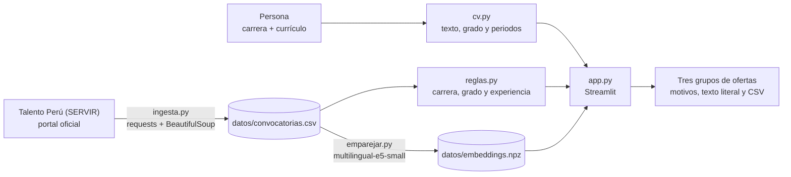

# Euthetos

> *Euthetos* (εὔθετος) significa «apto» o «bien dispuesto para algo» en griego antiguo.

**Hacemos que cualquier profesional sepa en un minuto a qué convocatorias del Estado peruano puede postular,
mediante un lector de requisitos que compara su currículo con todas las ofertas vigentes de Talento Perú.**

| | |
|---|---|
| **Demo** | **[euthetos.streamlit.app](https://euthetos.streamlit.app/)** · con un currículo ficticio: [enfermería](https://euthetos.streamlit.app/?demo=enfermeria), [ingeniería civil](https://euthetos.streamlit.app/?demo=ingenieria_civil), [derecho](https://euthetos.streamlit.app/?demo=derecho) |
| **Datos** | 3,938 ofertas vigentes de Talento Perú (SERVIR), leídas el 10 de noviembre de 2026 |
| **Costo por consulta** | S/ 0 en tokens: el modelo de lenguaje es abierto y corre dentro de la aplicación |
| **Proyecto** | Proyecto final del curso de Python Intermedio, Diplomatura de Ciencia de Datos para las Ciencias Sociales y la Gestión Pública (Q-Lab PUCP) |


---

## 1. One-liner

Hacemos que **cualquier profesional, de cualquier carrera**, sepa en un minuto **a qué convocatorias del Estado
peruano puede postular**, mediante un lector que compara su carrera, su grado y sus años de experiencia con los
requisitos publicados en **todas las ofertas vigentes de Talento Perú** (CAS, D. Leg. 276, D. Leg. 728, Ley 30057 y
demás regímenes), mostrando siempre el texto literal de cada requisito.

## 2. Founder

<!-- REVISAR R5: este párrafo lo confirma o reescribe Frank -->
Frank Pinares Gutiérrez es licenciado en Ciencia Política y Gobierno por la Pontificia Universidad Católica del
Perú (2026) y cursa la Diplomatura de Especialización en Ciencia de Datos para las Ciencias Sociales y la Gestión
Pública (Q-Lab PUCP). Durante 2026 postuló a prácticas y puestos en siete entidades públicas, de modo que conoce de
primera mano el problema que el presente proyecto busca resolver: revisar convocatoria por convocatoria si se
cumplen los requisitos, para descubrir muchas veces, al final de la lectura, que alguno de ellos no se cumple. Y es
que, antes de Euthetos, el autor ya había construido para su propia búsqueda un buscador diario de convocatorias y
un preparador de postulaciones, de los cuales se tomó la experiencia con el portal de Talento Perú.

## 3. Problema

**Quién lo sufre.** Toda persona que busca trabajo en el Estado peruano. Al 10 de noviembre de 2026, Talento Perú
publicaba 3,938 ofertas vigentes de 351 entidades en los 25 departamentos, de las cuales el 41% correspondía a Lima.

**Cuánto le cuesta.** El portal muestra diez ofertas por página y su buscador compara palabras sueltas del perfil,
de manera que, para saber si se cumple una oferta, debe abrirse su detalle y leer cuatro secciones (formación,
experiencia, especialización y conocimientos). Leer las 428 páginas y todos sus detalles le tomó a un programa,
con una pausa de dos segundos entre pedido y pedido, unas 2 horas y 45 minutos; para una persona, la misma tarea
equivaldría a varios días de lectura. Asimismo, buena parte de esa lectura se desperdicia, siendo que la mediana de
experiencia general exigida es de dos años y solo el 33% de las ofertas pide un año o menos.

**Cómo lo resuelve hoy.** <!-- REVISAR R5: completar con lo que digan las tres conversaciones -->
*Pendiente: se completará con las notas de las tres conversaciones con usuarios potenciales, que se encuentran en
[`docs/research/`](docs/research/).*

| Conversación | Perfil | Notas |
|---|---|---|
| 1 | *pendiente* | [`conversacion_1.md`](docs/research/conversacion_1.md) |
| 2 | *pendiente* | [`conversacion_2.md`](docs/research/conversacion_2.md) |
| 3 | *pendiente* | [`conversacion_3.md`](docs/research/conversacion_3.md) |

La guía usada para las conversaciones está en [`docs/research/guia_de_conversacion.md`](docs/research/guia_de_conversacion.md).

## 4. Solución e insight

**Solución.** La persona escribe su carrera y adjunta su currículo en PDF, Word o texto. Euthetos lee del
currículo el grado más alto y los periodos de trabajo, y le muestra a la persona cada periodo junto con la línea
de la que salió, para que desmarque los que no puede acreditar. Con ese perfil confirmado, compara cada una de las
ofertas vigentes y las separa en tres grupos: **cumples lo medible**, **conviene revisar** (carreras afines,
colegiatura, posgrado o un texto poco claro) y **te falta un requisito**. Dentro de cada grupo, las ofertas se
ordenan primero por si nombran la carrera de la persona y luego por su parecido con el currículo. Cada oferta
muestra por qué quedó en su grupo, junto con el texto literal publicado por la entidad y el enlace a sus bases.

**Insight.** Talento Perú ya publica los requisitos separados en secciones, de manera que lo medible (carrera,
grado y años de experiencia) puede leerse con reglas transparentes y comprobables, sin necesidad de un modelo de
lenguaje de pago que «decida» si alguien es apto. Así, la inteligencia artificial se reserva para lo que las
reglas no resuelven, es decir, ordenar miles de ofertas según su parecido con un currículo, y para ello basta un
modelo abierto y pequeño que corre gratis dentro de la aplicación. De esta forma, el costo por usuario es
prácticamente nulo, el currículo no se envía a ningún servicio externo y cada veredicto puede verificarse contra
el texto original.

## 5. Why now

- **Modelos abiertos pequeños y multilingües.** `intfloat/multilingual-e5-small` tiene 118 millones de parámetros,
  entiende el español y convierte un currículo en un vector en 0.18 segundos en la CPU de una laptop, sin clave ni
  costo por consulta.
- **Despliegue gratuito.** Streamlit Community Cloud permite publicar la aplicación sin servidor propio.
- **Agentes de programación.** El flujo completo, desde la lectura del portal hasta la aplicación desplegable, se
  construyó en un día con un agente de programación, lo cual hace viable que una sola persona mantenga el producto.

## 6. Demo

**URL pública:** https://euthetos.streamlit.app/ (en Streamlit Community Cloud). Si la aplicación estuvo
inactiva, la primera visita tarda alrededor de un minuto en despertarla y en cargar el modelo de lenguaje.

**Correrlo en local:**

```bash
python -m venv .venv
.venv\Scripts\activate            # en Windows; en Mac o Linux: source .venv/bin/activate
pip install -r requirements.txt
streamlit run app.py
```

La primera vez se descarga el modelo de lenguaje (unos 470 MB). Para probarla sin un currículo propio, en el panel
izquierdo puede elegirse uno de los tres currículos ficticios de [`datos/cv_ejemplo/`](datos/cv_ejemplo/), o
abrirse directamente con `?demo=enfermeria`, `?demo=ingenieria_civil` o `?demo=derecho` al final de la dirección.

**Actualizar los datos:**

```bash
python ingesta.py        # lee las ofertas vigentes de Talento Perú (unas 3 horas la primera vez)
python emparejar.py      # calcula los vectores de las ofertas (unos 10 minutos)
```

### Capturas

| Portada | Resultados | Detalle de una oferta |
|---|---|---|
|  |  |  |

### Arquitectura



### Modelos y fuentes, y por qué

| Pieza | Qué se usa | Por qué |
|---|---|---|
| Fuente de datos | Talento Perú (SERVIR), leído con `requests` y `BeautifulSoup` | Es el portal oficial de ofertas del Estado y reúne todos los regímenes. No tiene API: la página es una aplicación JSF que se recorre enviando el formulario con su `ViewState`, con dos segundos de pausa entre pedidos |
| Veredicto | Reglas escritas a mano (`reglas.py`), con 17 pruebas sobre textos reales | Son transparentes, gratuitas y comprobables: cada motivo se muestra junto al texto literal |
| Orden por parecido | `intfloat/multilingual-e5-small` con `sentence-transformers` | Modelo abierto que corre en CPU, sin clave ni costo; es el mismo de la Sesión 08 del curso |
| Interfaz | Streamlit | Permite publicar gratis y probar el flujo completo en vivo |

No se usa ningún modelo generativo de pago: el veredicto no lo decide un LLM, y el currículo nunca sale del
servidor de la aplicación.

## 7. Modelo de negocio

<!-- REVISAR R5: Frank define quién paga y el precio, idealmente a partir de las conversaciones -->
**Quién paga.** *Por definir con las conversaciones.* La propuesta inicial es que el uso individual sea gratuito y
que paguen las instituciones que acompañan a muchas personas en su búsqueda de empleo público: oficinas de
empleabilidad de universidades e institutos, colegios profesionales y oficinas de empleo municipales.

**Precio.** *Por definir.*

**Costo por usuario.**

| Concepto | Costo |
|---|---|
| Tokens de modelos de pago | S/ 0: no se usa ninguno |
| Cálculo del vector de un currículo | 0.18 segundos de CPU (medido en una laptop) |
| Servidor | S/ 0 en Streamlit Community Cloud |
| Actualización de las ofertas | Una lectura de Talento Perú al día; en una laptop, la primera lectura toma unas 3 horas y las siguientes solo abren las ofertas nuevas |
| Almacenamiento del currículo | Ninguno: se lee en memoria y no se guarda |

## 8. Herramientas del curso

| Herramienta | Sesión | Archivo | Para qué se usa |
|---|---|---|---|
| Web scraping | 03 · Scraping y APIs | [`ingesta.py`](ingesta.py) | Leer las ofertas vigentes y el detalle de cada una en Talento Perú |
| Embeddings y búsqueda por significado (la «R» de RAG) | 08 · LLMs y RAG | [`emparejar.py`](emparejar.py) | Ordenar las ofertas según su parecido con el currículo, con los prefijos `query:` y `passage:` y el producto punto `E @ q` vistos en clase |
| Dashboard y despliegue | 05 · Dashboards y 12 · Despliegue | [`app.py`](app.py) | La aplicación que usa la persona |

Se eligieron estas herramientas porque el problema exige, en primer lugar, reunir datos que no tienen API (el
scraping) y, en segundo lugar, ordenar miles de textos según su significado y no según palabras exactas (los
embeddings), siendo que un currículo y una oferta rara vez usan las mismas palabras para decir lo mismo.

## 9. Qué hizo el agente

<!-- REVISAR R5 -->
El código fue generado con un agente de programación (Claude Code), a partir de un diseño previo aprobado por el
autor y de revisiones manuales en cada etapa:

| Parte | Qué hizo el agente | Qué decidió o revisó el autor |
|---|---|---|
| Problema y alcance | Propuso cuatro ideas sin costo adicional | Eligió el problema, el nombre y el alcance: todas las carreras y todos los regímenes, sin modelos de pago |
| `ingesta.py` | Adaptó el lector de Talento Perú de un proyecto anterior del autor y lo hizo reanudable | Aprobó la fuente y el ritmo de lectura |
| `reglas.py` y pruebas | Escribió las reglas y 17 pruebas con textos reales | Revisó los veredictos en la aplicación |
| `cv.py` | Escribió la lectura del currículo | Detectó que sumaba periodos no acreditables; de ahí salió la tabla de periodos que la persona confirma |
| `emparejar.py` | Llevó la búsqueda semántica de la Sesión 08 a las ofertas | — |
| `app.py` | Escribió la interfaz y tres rediseños | Pidió una interfaz sin emojis, más profesional y luego con más color, inspirada en los portafolios del curso |
| Conversaciones con usuarios | Escribió la guía de preguntas | Hizo las tres conversaciones |

---

## Limitaciones

- Las reglas no leen el grado exigido en el 8% de las ofertas ni la experiencia en el 10%; esas ofertas pasan a
  «conviene revisar», nunca a «cumples».
- Euthetos no sabe si una carrera es «afín» a otra ni evalúa la especialización ni los conocimientos: lo indica para
  que la persona lo lea.
- La lectura de periodos funciona con fechas escritas como «marzo 2021 – agosto 2023», «03/2021 – 08/2023» o
  «2021 – 2023»; un currículo escaneado no puede leerse.
- Euthetos no reemplaza la lectura de las bases: quien decide si una persona es apta es el comité de selección.

## Privacidad

El currículo se lee en memoria y no se guarda. Los tres currículos de ejemplo son ficticios. Los datos de las
ofertas son públicos y provienen del portal oficial de Talento Perú.

## Licencia

[MIT](LICENSE).
